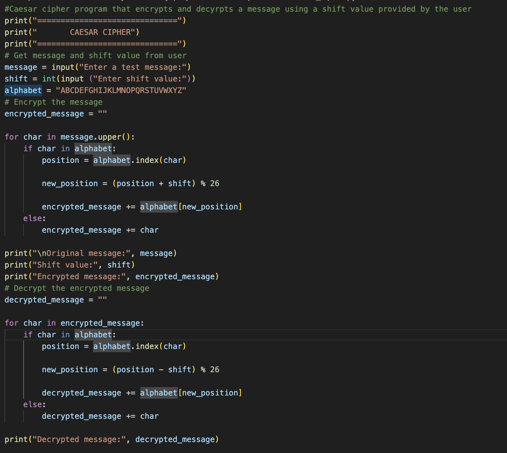
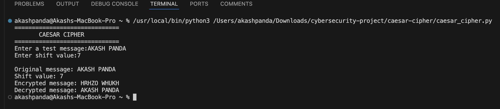

# Caesar Cipher

## Project Description
This project is a beginner-friendly Python implementation of the Caesar Cipher technique. It allows users to encrypt and decrypt messages by shifting letters in the alphabet.

## Technologies Used
- Python 3
- VS Code

## Features
- Encrypts text using a shift value.
- Decrypts encrypted text.
- Supports uppercase and lowercase input.
- Preserves spaces and special characters.
- Handles alphabet wrap-around (Z to A).

## How to Run

1. Install Python 3.
2. Download or clone this repository.
3. Open the project folder in VS Code.
4. Open the terminal.
5. Run:

```bash
python3 caesar_cipher.py
```

6. Enter a test message and a shift value when prompted.

## Example

**Input:**
- Message: AKASH PANDA
- Shift: 7

**Output:**
- Encrypted Message: HRHZO WHUKH
- Decrypted Message: AKASH PANDA

## Learning Outcomes
- Understanding basic encryption and decryption.
- Using Python loops and conditions.
- Working with strings and alphabet positions.
- Understanding the Caesar Cipher algorithm.

## Disclaimer
The Caesar Cipher is a historical educational encryption technique. It is not secure for protecting real or sensitive information.

## Screenshots

### Python Source Code


### Program Output

